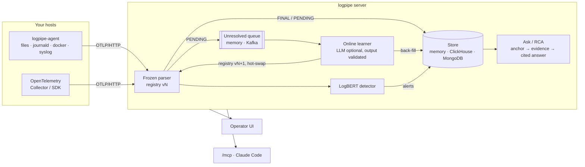

<p align="center">
  
</p>

<h1 align="center">logpipe</h1>

<p align="center">
  <b>Streaming log parsing that learns new formats on its own, flags unusual sequences with LogBERT,<br>
  and answers "why did it break?" with an evidence report that cites real log lines.</b>
</p>

<p align="center">
  <a href="LICENSE"></a>
  <a href="https://niang931.github.io/Log_parser/"></a>
  
  
  
  
  
  
  
  
  
  
</p>

---

logpipe takes raw log lines from files, Go agents on your hosts or any OpenTelemetry sender and:

- **parses** each one on a sub-millisecond hot path (frozen Drain, about 30 µs at the median), storing
  lines it doesn't know as `PENDING` instead of waiting;
- **learns** templates for those lines in the background (cluster → validate → name fields → link
  rewordings → registry vN+1 → hot-swap → back-fill), with an LLM that is optional and never trusted;
- **detects** unusual sequences per device or stream with LogBERT, plus a novelty signal and fleet
  suppression so a rollout doesn't page you;
- **explains** incidents: a deterministic RCA engine finds when it broke and ranks evidence; an LLM
  writes a cited answer, or says the evidence is insufficient; every read can require approval;
- **serves** an operator UI, a SQL / visual query layer, and an MCP endpoint for Claude Code.

## Overview



## Quick start

```sh
git clone git@github.com:Niang931/Log_parser.git && cd Log_parser
make setup                       # uv sync + .env
uv run logpipe                   # interactive: asks what to run and starts it
```

| Try | Command |
|---|---|
| The pipeline live in a browser (synthetic IoT fleet, ~10 s to start) | `uv run logpipe demo` |
| A guided tour: server, a web shop's logs, a real agent, an outage | `uv run logpipe showcase --auto` |
| The platform: agents + server + UI on :8080 | `docker compose --profile platform up --build` |
| Your own log files in batch | `make calibrate train run` (with `LOGS_PATH` in `.env`) |
| Connect Claude Code | `claude mcp add --transport http logpipe http://localhost:8080/mcp --header "Authorization: Bearer lp_..."` |
| Every benchmark | `make eval` |
| Root cause on RCAEval | `make eval-rcaeval DATASET=re3-ob [LLM=llm:web:gemini BROWSER=chromium \| VIA=mcp]` |
| Tests | `make test-fast` · `make test` · `make test-integration` |
| Docs locally | `make docs` |

Requirements: [uv](https://docs.astral.sh/uv/) (installs Python 3.13); Docker for ClickHouse, MongoDB
and Kafka; Go 1.23+ to build the agent. The LLM is optional: `offline` rules, a hosted API
(`llm:anthropic`, …), a fine-tuned local model (`hf`, GPU) or your own signed-in web chat
(`llm:web:gemini`, no API key).

## Results

| What | Benchmark | Result |
|---|---|---|
| Parsing | Loghub-2k, 14 systems, tuned | GA **0.81** (DeepParse 0.70) |
| Template linking | 28 labelled pairs, offline rules | **0** false merges |
| Anomaly detection | BGL / HDFS, LogBERT + novelty | F1 **0.95** / **0.80** |
| IoT fleet end to end | firmware rollout + 5 anomaly kinds | F1 0.56 (0.34 without fleet suppression) |
| Root cause, real testbed | RCAEval RE3-OB, 30 code-level faults | AC@1: rules **0.40** → + Gemini **0.70** → Claude Code over MCP **0.87–0.90** |
| Hot path | IoT replay | parse p50 **32 µs**, p99 68 µs; ~10k lines/s per server core |

Methods and caveats: [Benchmarks](https://niang931.github.io/Log_parser/benchmarks/).

## Documentation

| | |
|---|---|
| [Getting started](https://niang931.github.io/Log_parser/getting-started/) | install, every way to run it, all commands |
| [Architecture](https://niang931.github.io/Log_parser/architecture/) | parsing, online learning, LogBERT, server lifecycle, Ask & RCA, MCP, storage, with diagrams |
| [Benchmarks](https://niang931.github.io/Log_parser/benchmarks/) | results, RCAEval, throughput |
| [Guides](https://niang931.github.io/Log_parser/guides/code-structure/) | code structure, replacing components, configuration, maintenance, CI |
| [Security](https://niang931.github.io/Log_parser/security/) | threat model and defences |
| [Design records](https://niang931.github.io/Log_parser/plan/) | personas, feature plans and technical decisions |

The same pages are in [`docs/`](docs/).

## Repository

```
logpipe/      the product: parsing, registry, learner, LogBERT, server, Ask/RCA, MCP, evals
DeepParse/    mask synthesis, Drain engine, chat providers, web-chat driver
agent/        logpipe-agent (Go collector)
web/          operator UI (React + Vite)
tests/        pytest (DeepParse/tests for DeepParse)
docs/         documentation site (MkDocs Material)
```

## License

logpipe is released under the [MIT License](LICENSE). The vendored `DeepParse/` directory stays under
the Apache License 2.0 ([DeepParse/LICENSE](DeepParse/LICENSE)). Third-party code, models and
datasets, with their licenses and the changes made, are listed in
[THIRD_PARTY_NOTICES.md](THIRD_PARTY_NOTICES.md).

## Acknowledgements

- **DeepParse**: Shetaia & Kauffman, *DeepParse: Hybrid Log Parsing with LLM-Synthesized Regex Masks*, EASE 2026 · [arXiv:2604.20553](https://arxiv.org/abs/2604.20553) · [code](https://github.com/NightBaRron1412/DeepParse) (Apache-2.0, vendored in `DeepParse/`)
- **LogBERT**: Guo, Yuan & Wu, *LogBERT: Log Anomaly Detection via BERT*, IJCNN 2021 · [arXiv:2103.04475](https://arxiv.org/abs/2103.04475) · [code](https://github.com/HelenGuohx/logbert) (MIT, adapted in `logpipe/anomaly/logbert/`)
- **BERT-pytorch**: the transformer code LogBERT derives from · [code](https://github.com/codertimo/BERT-pytorch) (Apache-2.0)
- **Drain**: He, Zhu, Zheng & Lyu, *Drain: An Online Log Parsing Approach with Fixed Depth Tree*, ICWS 2017
- **Loghub**: Zhu, He, He, Liu & Lyu, *Loghub: A Large Collection of System Log Datasets for AI-driven Log Analytics*, ISSRE 2023 · [data](https://github.com/logpai/loghub)
- **RCAEval**: Pham, Zhang, Ha, Salim & Zhang, *RCAEval: A Benchmark for Root Cause Analysis of Microservice Systems with Telemetry Data*, WWW 2025 Companion · [doi](https://doi.org/10.1145/3701716.3715290) · [code](https://github.com/phamquiluan/RCAEval) (MIT)
- **all-MiniLM-L6-v2**: sentence-transformers text model behind Ask's template search (Apache-2.0)
