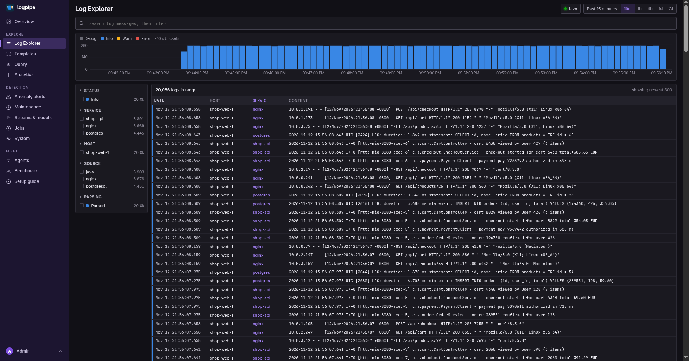

<p align="center">
  
</p>

<h1 align="center">logpipe</h1>

<p align="center">
  <b>Streaming log parsing that learns new formats on its own, flags unusual sequences with LogBERT,<br>
  and answers "why did it break?" with an evidence report that cites real log lines.</b>
</p>

<p align="center">
  <a href="LICENSE"></a>
  <a href="https://niang931.github.io/Log_parser/"></a>
  
  
</p>

---
<p align="center">
  
</p>

---

## Features

| Feature | What it does |
|---|---|
| **Parse** | Each line goes through a sub-millisecond hot path (frozen Drain, about 30 µs at the median). Lines it doesn't know are stored as `PENDING` instead of waiting. |
| **Learn** | Templates for those lines are learned in the background: cluster → validate → name fields → link rewordings → registry vN+1 → hot-swap → back-fill. The LLM is optional and never trusted. |
| **Detect** | LogBERT flags unusual sequences per device or stream, plus a novelty signal and fleet suppression so a rollout doesn't page you. |
| **Explain** | A deterministic RCA engine finds when it broke and ranks evidence; an LLM writes a cited answer, or says the evidence is insufficient. Every read can require approval. |
| **Serve** | An operator UI, a SQL / visual query layer, and an MCP endpoint for Claude Code. |


## Overview

```mermaid
flowchart LR
    subgraph hosts["Your hosts"]
        direction TB
        F["Files"]
        J["journald"]
        DK["Docker"]
        SL["syslog"]
        AG["logpipe-agent<br/><i>Go · tails, batches, retries</i>"]
        OT["OpenTelemetry<br/><i>Collector / SDK</i>"]
        F & J & DK & SL --> AG
    end

    AG -- "OTLP/HTTP<br/>POST /v1/logs" --> P
    OT -- "OTLP/HTTP<br/>POST /v1/logs" --> P

    subgraph server["logpipe server"]
        direction LR
        subgraph hot["Hot path · ~30 µs"]
            P["Frozen Drain parser<br/><i>registry vN</i>"]
        end
        subgraph learn["Online learning · background"]
            Q[["Unresolved queue<br/><i>memory · Kafka</i>"]]
            W["Learner<br/>cluster → validate →<br/>name fields → link rewordings"]
            LLM(["LLM<br/><i>optional, output validated</i>"])
            Q --> W
            LLM -.-> W
        end
        ST[("Store<br/><i>memory · ClickHouse · MongoDB</i>")]
        subgraph detect["Detection"]
            D["LogBERT<br/><i>per device / stream</i>"]
            N["Novelty +<br/>fleet suppression"]
            D --> N
        end
        subgraph explain["Ask / RCA"]
            RCA["Deterministic RCA<br/>anchor → ranked evidence"]
            ANS["Cited answer<br/><i>or ‘insufficient evidence’</i>"]
            RCA --> ANS
        end

        P -- "FINAL / PENDING" --> ST
        P -- "PENDING" --> Q
        W == "registry vN+1<br/>hot-swap" ==> P
        W -- "back-fill" --> ST
        P --> D
        N -- "alerts" --> ST
        ST --> RCA
    end

    ST --> UI["Operator UI<br/><i>explorer · query · alerts</i>"]
    ANS --> UI
    ST --> SQL["SQL / visual query<br/><i>/api/query</i>"]
    ANS --> MCP["/mcp<br/><i>Claude Code</i>"]

    classDef src fill:#1e293b,stroke:#64748b,color:#e2e8f0
    classDef hotc fill:#1e3a8a,stroke:#60a5fa,color:#fff
    classDef learnc fill:#3b0764,stroke:#c084fc,color:#fff
    classDef store fill:#064e3b,stroke:#34d399,color:#fff
    classDef det fill:#7f1d1d,stroke:#f87171,color:#fff
    classDef rca fill:#78350f,stroke:#fbbf24,color:#fff
    classDef out fill:#0f172a,stroke:#94a3b8,color:#e2e8f0
    class F,J,DK,SL,AG,OT src
    class P hotc
    class Q,W,LLM learnc
    class ST store
    class D,N det
    class RCA,ANS rca
    class UI,SQL,MCP out
    style hosts fill:#0f172a,stroke:#475569,color:#cbd5e1
    style server fill:#0b1220,stroke:#475569,color:#cbd5e1
    style hot fill:#172554,stroke:#3b82f6,color:#bfdbfe
    style learn fill:#2e1065,stroke:#a855f7,color:#e9d5ff
    style detect fill:#450a0a,stroke:#ef4444,color:#fecaca
    style explain fill:#451a03,stroke:#f59e0b,color:#fde68a
    linkStyle default stroke:#94a3b8,stroke-width:1.5px
```



## Setting up the server

The server takes in agent logs, runs the operator UI on port 8080 and trains the models. It
stores data in ClickHouse (or MongoDB). On the first start it prints the UI admin password,
unless `LOGPIPE_ADMIN_PASSWORD` is set.

### Using the shipped container

```sh
git clone git@github.com:Niang931/Log_parser.git && cd Log_parser
cp .env.example .env             # set the passwords
docker compose pull server       # ghcr.io/niang931/logpipe-server:latest
docker compose up -d clickhouse server
docker compose logs server | grep -i password
```

Open http://localhost:8080 and follow the setup guide. To also start a demo log generator and an
agent, use `--profile platform up -d`. To run on MongoDB, use `--profile platform-mongo`.
If you already run ClickHouse, run the image on its own:

```sh
docker run -d --name logpipe-server --restart unless-stopped -p 8080:8080 \
  --env-file .env -e CLICKHOUSE_HOST=clickhouse.example \
  -v logpipe-server:/app/artifacts ghcr.io/niang931/logpipe-server:latest
```

### From source

Needs [uv](https://docs.astral.sh/uv/), Node 20+ and Docker (for ClickHouse).

```sh
git clone git@github.com:Niang931/Log_parser.git && cd Log_parser
make setup                                   # uv sync + .env
cd web && npm ci && npm run build && cd ..   # UI into logpipe/server/static
docker compose up -d clickhouse
uv run logpipe server --store clickhouse     # prints the admin password on first start
```

## Install the agent

Ship a host's logs to the server with `logpipe-agent` 
1. create an **Agent** key under **Settings → API keys** first
2. Paste the **API key** and **URL** into the command below

```sh
docker run -d --name logpipe-agent --restart unless-stopped \
  -e LOGPIPE_ENDPOINT=http://logpipe.example:8080 -e LOGPIPE_API_KEY=lp_xxx -e LOGPIPE_HOSTNAME=$(hostname) \
  -v /var/log:/var/log:ro -v /var/run/docker.sock:/var/run/docker.sock:ro \
  -v logpipe-agent:/var/lib/logpipe-agent ghcr.io/niang931/logpipe-agent:latest
```

or from source (Go 1.23+), no root needed

```sh
cd agent && go build -o logpipe-agent .
./logpipe-agent init --endpoint http://logpipe.example:8080 --api-key lp_xxx
./logpipe-agent track '/var/log/myapp/*.log' --service myapp --source java --auto-multiline
./logpipe-agent check && ./logpipe-agent run
```

See full guide here: [Install the agent](https://niang931.github.io/Log_parser/getting-started/agent/).

## Benchmark

| What | Benchmark | Result |
|---|---|---|
| Parsing | Loghub-2k, 14 systems, tuned | GA **0.81** (DeepParse 0.70) |
| Template linking | 28 labelled pairs, offline rules | **0** false merges |
| Anomaly detection | BGL / HDFS, LogBERT + novelty | F1 **0.95** / **0.80** |
| IoT fleet end to end | firmware rollout + 5 anomaly kinds | F1 0.56 (0.34 without fleet suppression) |
| Root cause, real testbed | RCAEval RE3-OB, 30 code-level faults | AC@1: rules **0.40** → + Gemini **0.70** → Claude Code over MCP **0.87–0.90** |
| Hot path | IoT replay | parse p50 **32 µs**, p99 68 µs; ~10k lines/s per server core |

## Documentation

| | |
|---|---|
| [Getting started](https://niang931.github.io/Log_parser/getting-started/) | install, every way to run it, all commands |
| [Architecture](https://niang931.github.io/Log_parser/architecture/) | parsing, online learning, LogBERT, server lifecycle, Ask & RCA, MCP, storage, with diagrams |
| [Benchmarks](https://niang931.github.io/Log_parser/benchmarks/) | results, RCAEval, throughput |
| [Guides](https://niang931.github.io/Log_parser/guides/code-structure/) | code structure, replacing components, configuration, maintenance, CI |
| [Security](https://niang931.github.io/Log_parser/security/) | threat model and defences |
| [Design records](https://niang931.github.io/Log_parser/plan/) | personas, feature plans and technical decisions |

## Acknowledgements

- **DeepParse**: Shetaia & Kauffman, *DeepParse: Hybrid Log Parsing with LLM-Synthesized Regex Masks*, EASE 2026 · [arXiv:2604.20553](https://arxiv.org/abs/2604.20553) · [code](https://github.com/NightBaRron1412/DeepParse) (Apache-2.0, vendored in `DeepParse/`)
- **LogBERT**: Guo, Yuan & Wu, *LogBERT: Log Anomaly Detection via BERT*, IJCNN 2021 · [arXiv:2103.04475](https://arxiv.org/abs/2103.04475) · [code](https://github.com/HelenGuohx/logbert) (MIT, adapted in `logpipe/anomaly/logbert/`)
- **BERT-pytorch**: the transformer code LogBERT derives from · [code](https://github.com/codertimo/BERT-pytorch) (Apache-2.0)
- **Drain**: He, Zhu, Zheng & Lyu, *Drain: An Online Log Parsing Approach with Fixed Depth Tree*, ICWS 2017
- **Loghub**: Zhu, He, He, Liu & Lyu, *Loghub: A Large Collection of System Log Datasets for AI-driven Log Analytics*, ISSRE 2023 · [data](https://github.com/logpai/loghub)
- **RCAEval**: Pham, Zhang, Ha, Salim & Zhang, *RCAEval: A Benchmark for Root Cause Analysis of Microservice Systems with Telemetry Data*, WWW 2025 Companion · [doi](https://doi.org/10.1145/3701716.3715290) · [code](https://github.com/phamquiluan/RCAEval) (MIT)
- **all-MiniLM-L6-v2**: sentence-transformers text model behind Ask's template search (Apache-2.0)
