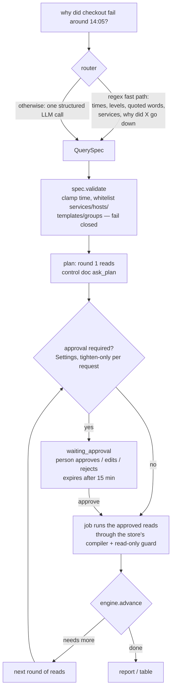
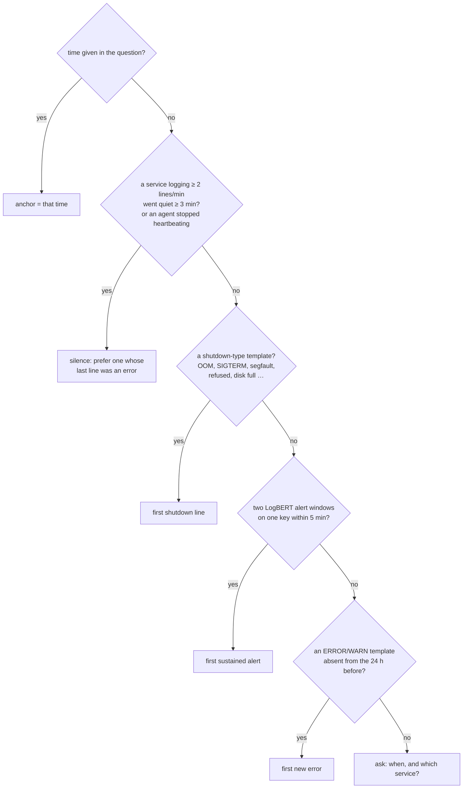

# Ask and root-cause analysis

**Ask** (`logpipe/ask/`) turns a plain-English question into a validated plan of read-only
queries, runs them once approved, and answers with a table or with a **root-cause report**
that cites the lines it rests on. The LLM only routes the question and writes the final
explanation. It never writes SQL and never reads logs in bulk.

## The flow



| Intent | Example | Result |
|---|---|---|
| `keyword` | "errors from shop-api in the last hour containing 'timeout'" | lines, or an aggregate (count / avg … per group, over time) |
| `event` | "when did the payment gateway time out?" | lines of the templates that match the event |
| `semantic` | "anything about running out of memory?" | templates near the text (MiniLM), then their lines |
| `rca` | "why did checkout fail around 14:05?" | a root-cause report |
| `summary` | "what happened on db-1 today?" | a report over the whole range |
| `general` | "what is a 502?" | a short answer labelled *not from your logs* |

### Safety model

- **QuerySpec only.** Whatever produced the spec (fast path, LLM, a person editing it), it's
  validated against what actually exists; anything it can't vouch for is refused.
- **The server enforces approval**, not the UI. With approval off in Settings, rounds are
  approved as planned; a request can turn approval *on* but never off.
- **Read-only at three layers**: specs compile through the store adapter's builder (never raw
  LLM SQL); the SQL guard (`enrich/sql_guard.py`) blocks writes and ClickHouse table functions
  (`url`, `file`, `remote`, `s3` …); and the reads run as a read-only database user
  (`CLICKHOUSE_READONLY_USER`, `MONGO_READONLY_URI`, SQLite `query_only` on a copy).
- **Citations are checked.** Every timeline entry and hypothesis must cite refs that exist in
  the bundle (`L3` a line, `T12` a template, `H1` a value hint, `S1` a rate); anything else is
  dropped. With nothing left, the answer is "insufficient evidence".

## The RCA engine (no LLM)

`ask/rca.py`. Every number is in `RcaSettings` (`LOGPIPE_RCA_*`).

### 1. Anchor: when did it break?

The first rule that holds wins. If none holds, the engine asks the user instead of guessing.



The shutdown set is a fixed pattern plus the templates closest (MiniLM) to a few seed phrases,
editable on the Templates page (control doc `ask_shutdown`).

### 2. Window and baseline

Read `[anchor − 30 min, anchor + 2 min]`. If fewer than 3 candidates stand out (score ≥ 0.15),
widen once to `[anchor − 2 h, anchor + 5 min]`. The **baseline** is the same window length
sliced over the 24 h before. Slices are whole windows that end where the window starts, so the
slice right before the incident always counts; only slices the store has any line in count as
history.

### 3. Score each (template, service) in the window

```
score = anomaly × rarity × proximity
```

| Factor | Value |
|---|---|
| **anomaly** | the largest of: level (error 0.8, warn 0.5, else 0.1); 0.9 for a shutdown template; the share of its lines LogBERT didn't expect; 0.5 if it's a LogBERT neighbour of the anchor or matches the question's words |
| **rarity** | 1.0 if absent from the baseline (new); else `(count / expected − 1) / 9`, clamped to 0.02…1; 0.5 when the store has no history at all |
| **proximity** | `exp(−|first seen − anchor| / 10 min)` |

Ties go to the earlier template: a cause comes before its effects. A new template first seen
up to 2 minutes before the strongest one is lifted to anomaly 0.8 (a **precursor**), and the
earliest template scoring at least half the best is marked **earliest in chain**. Each
candidate keeps its factor breakdown, so the report can say why every line is there.

### 4. Evidence bundle and value hints

Up to 40 lines of up to 300 characters each (~6k tokens): the anchor, the top candidates' example
lines, and the anchor service's last lines before the anchor. **Value hints** answer *where*
rather than *what*: a host, source or extracted field value on ≥ 20 % of the error lines and
≥ 3× more common there than among the other lines becomes `H1…` (ids and fields only error
lines carry are skipped).

## The synthesizer (LLM)

`ask/synth.py`. The LLM sees the question, the bundle (lines with refs), hints, the groups the
services belong to, and the ranking. It returns a structured `Answer`: summary, cited timeline,
ranked hypotheses with confidence and `cites`, `insufficient_evidence`, next steps. The citation
check drops anything uncited.

The LLM may also ask for **typed follow-up moves** (`ask/moves.py`), never SQL:

| Move | Reads | Checked |
|---|---|---|
| `lines` | keywords and/or services in a window it picks | known services, ≤ 24 h before the anchor |
| `trace` | an id copied from the bundle, across every service | the id must occur in the bundle |
| `rate` | error or all lines per service per step (cited `S1…`) | known services |
| `neighbours` | errors in any service near the anchor | — |

Up to 3 moves a round and 4 follow-up rounds, each approved like any other read.

**Without an LLM** the answer is the evidence itself: a timeline of the bundle and the top
candidates (plus a strong hint) as *leads*, labelled a ranking, not a diagnosis.

## Where it's used

- **Ask box** in the UI (Query page and a global shortcut), with plan approval, a live LLM
  activity log, and the report as verdict + Answer / Evidence / Ranking tabs.
- **Alerts → Explain** runs an RCA anchored on the incident.
- **MCP `ask` tool** approves its own rounds and returns the report to Claude
  ([MCP](mcp.md)).
- **Evals**: `rca_eval.py` (19 injected faults) and `rcaeval_bench.py` (RCAEval)
  ([Benchmarks](../benchmarks/index.md)).

Design history and decisions: [AI root cause records](../plan/ai-rca/tech-decisions.md).
