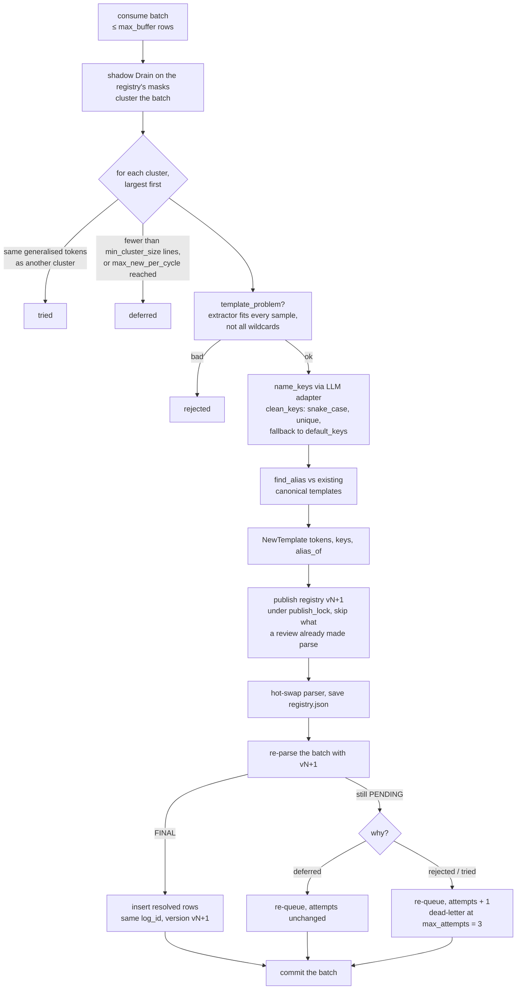
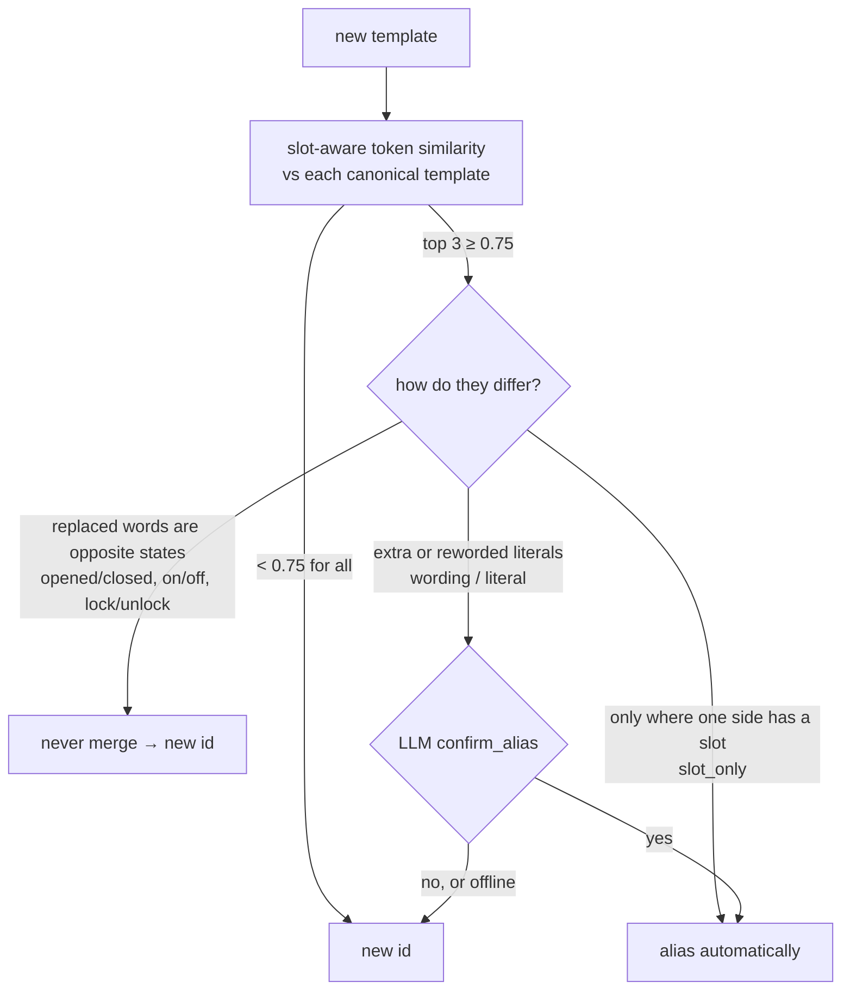

# Online template learning

Lines the frozen parser can't match are stored as `PENDING` immediately and published to the
**unresolved queue**. The enrichment worker (`enrich/worker.py`) learns templates for them in
**cycles** and back-fills the stored rows. Parsing never waits for it.

## One cycle

Why clustering first: a burst of 100k lines of one new event costs **one** LLM call, not
100k. Why the order back-fill → re-queue → commit: a crash before the commit redelivers the
batch, and the back-fill is idempotent (same `log_id`, same version), so delivery is
*at least once* with no duplicates in the store.

| Parameter | Default | Meaning |
|---|---|---|
| `max_buffer` | 200,000 | rows per cycle (and the memory queue's capacity) |
| `min_cluster_size` | 1 | clusters smaller than this are deferred until more lines arrive |
| `max_new_per_cycle` | 50 | templates one cycle may create; the rest are deferred |
| `alias_threshold` | 0.75 | slot-aware token similarity to consider an alias |
| `max_attempts` | 3 | failed tries before a row goes to the dead-letter queue |

A **circuit breaker** stops calling the LLM after 3 consecutive failures and retries after 5
cycles. Meanwhile key names fall back to the offline heuristics, so learning continues.

When does a cycle run? In `logpipe run` with the memory queue, every `--enrich-every` lines and
at the end. In the server, every 30 s on its housekeeping thread. With Kafka, continuously in
each `logpipe worker`. Evals that need everything learned before asking a question call
`settle()` (`eval/rca_eval.py`), which runs cycles until one creates no template (cap 10), since
clusters too small for a template stay queued forever.

## Alias decisions

When a new template looks like an existing one, is it the same event?

- Embedding similarity is deliberately **not** used: sentence embeddings put "Door opened" and
  "Door closed" above 0.9 cosine, and merging those erases the distinction anomaly detection
  depends on.
- The offline adapter never confirms a wording change. Two ids are recoverable (link them in the
  UI later); a wrong merge isn't.
- Measured on 28 labelled pairs: offline rules make **0 false merges** (precision 1.0, recall
  0.6); an always-yes LLM makes 2; token similarity alone makes 10.
  [Results →](../benchmarks/results.md#alias-decisions)

## Validation of anything a model proposes

`enrich/validate.py`. Log text comes from devices and can carry prompt injection, so:

| Proposal | Check | On failure |
|---|---|---|
| masks | `safe_masks`: compiles, not catastrophic (ReDoS), doesn't match everything | dropped |
| template | `template_problem`: its extractor matches every sample, not all wildcards | cluster rejected |
| key names | `clean_keys`: snake_case, `KEY_RE`, unique, one per slot | `default_keys` |
| alias answer | opposite-state veto runs before the LLM | never merged |

`tests/test_prompt_injection.py` runs a corpus of hostile log lines against an adapter that
does whatever they ask; every guard must still refuse.

## Queue backends

The worker reads from an `UnresolvedQueue` (`unresolved/base.py`):

- **`MemoryQueue`**: in process; the default and the test double.
- **`KafkaQueue`**: durable, partitioned by line *shape* so one worker sees a whole
  candidate cluster, with a dead-letter topic, a local spill buffer when the broker is down,
  and commit-after-back-fill. [Details →](../kafka.md)
