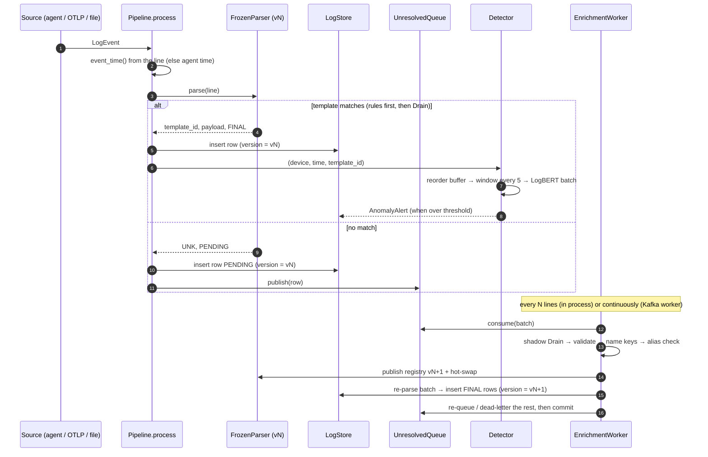

# Architecture

logpipe is one Python process, or a fast-path process plus N learning workers when the queue
is Kafka. It is built from components that each have a single owner and a narrow interface.
The rule behind the layout: **the hot path never waits on anything slow** (a model, a person,
a network round-trip). Everything slow happens beside it and publishes its result as a new,
immutable registry version.

## Components

| Component | Code | Owns | Interface |
|---|---|---|---|
| Sources | `logpipe/sources/`, `server/otlp.py`, `agent/` | turning files, OTLP and agent batches into `LogEvent`s | `LogEvent(device_id, source, line, service, tags, time)` |
| Frozen parser | `parsing/frozen_parser.py` | line → `template_id`, payload, `FINAL`/`PENDING` | `ParserHandle.parse()`, `.swap(snapshot)` |
| Schema registry | `registry.py` | template ids (monotonic, never reused), aliases, masks, key names | immutable `RegistrySnapshot`, `SchemaRegistry.publish()` |
| Store | `storage/` | rows (versioned upserts), alerts | `LogStore` protocol |
| Unresolved queue | `unresolved/` | PENDING rows on their way to the learner | `UnresolvedQueue` protocol (memory, Kafka) |
| Enrichment worker | `enrich/worker.py` | learning templates online, back-filling rows | `run_cycle() -> CycleReport` |
| LLM adapter | `enrich/llm.py` | masks, key names, alias confirmation, structured answers | `LLMAdapter` protocol |
| Detector | `anomaly/detector.py`, `scorer.py` | windows → LogBERT scores → alerts | `Scorer` protocol |
| Server | `server/` | intake, control plane, lifecycle jobs, UI API, metrics, MCP | FastAPI app |
| Ask / RCA | `ask/` | question → approved reads → cited report | `AskService` |
| Store adapters | `server/stores/` | UI reads and the query compiler per backend | `StoreReads`, `Compiler` |

## Data flow of one line



The ReplacingMergeTree trick ties it together. A PENDING row and its later FINAL back-fill have
the same `log_id` and sort key, and the back-fill carries a higher `version`, so reading with
`FINAL` (ClickHouse) or "latest version per `log_id`" (memory, Mongo) always sees the best parse.
That is also why a redelivered Kafka batch changes nothing.

## Process layouts

=== "Single process (default)"

    ```mermaid
    flowchart LR
        S[sources] --> P[parse] --> ST[(store)]
        P --> Q[[memory queue]] --> W[worker<br/>every enrich_every lines] --> P
        P --> D[detector]
    ```

=== "Fast path + Kafka workers"

    ```mermaid
    flowchart LR
        S[sources] --> P["logpipe run --no-enrich"] --> ST[(ClickHouse)]
        P -->|produce, never blocks| K[[Kafka topic<br/>keyed by line shape]]
        K --> W1[logpipe worker]
        K --> W2[logpipe worker]
        W1 & W2 -->|back-fill| ST
        W1 & W2 --> R[(registry.json)]
    ```

    A fast-path process doesn't reload a registry another process wrote. Templates learned by a
    separate worker reach it on restart (see [Kafka](../kafka.md#known-gaps)).

=== "Server"

    ```mermaid
    flowchart LR
        AG[agents / OTLP] --> I[intake buffer] --> P[pipeline] --> ST[(store)]
        P --> J[jobs: draft, apply, retrain,<br/>reextract, ask rounds]
        J --> R[(registry + per-stream models<br/>in --data-dir)]
        UI[React UI] & MCP["/mcp"] --> API["/api/*"] --> P & ST & J
    ```

## Design principles

1. **Ids are owned by the registry, not by Drain.** Drain renumbers clusters on rebuild; every id
   that leaves the parser (rows, LogBERT vocabularies, aliases) comes from the registry, and is
   allocated monotonically and never reused.
2. **Snapshots, not locks, on the hot path.** Readers hold an immutable snapshot; a publish makes
   vN+1 and swaps the handle. A parse never sees a half-updated tree.
3. **Masks never change online.** A new mask would re-tokenise existing templates' lines and
   silently break them, so mask changes go through offline recalibration.
4. **Everything a model says is untrusted.** Log text is attacker-controlled, so LLM output is
   validated (keys, masks, templates, alias answers, SQL) and has a deterministic fallback.
   `offline` is a complete backend, never a degraded one.
5. **A wrong merge is worse than a missed one.** Two ids for one event are recoverable (link
   them later); one id for "door opened" and "door closed" destroys exactly what anomaly
   detection needs.
6. **People approve; the AI proposes.** Templates go live after review, Ask reads can require
   approval, and MCP keys can't apply batches or change incident state.

Deep dives: [Parsing](parsing.md) · [Online learning](enrichment.md) · [LogBERT](anomaly.md) ·
[Server lifecycle](../agent-platform.md) · [Ask & RCA](ask-rca.md) · [MCP](mcp.md) ·
[Storage](storage.md)
