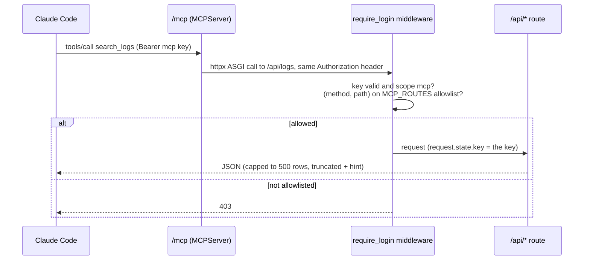

# MCP for AI assistants

`logpipe server` exposes a Streamable-HTTP MCP endpoint at **`/mcp`** (`server/mcp_tools.py`),
so Claude Code or any MCP client can investigate with your logs. The client AI does the
reasoning; logpipe supplies data, a narrow set of *proposal* writes, and its own RCA engine.

## Connect

1. **Settings → API keys** → create a key with use **AI assistant** (scope `mcp`). Give each
   person their own key: notes and draft decisions show `by <key name>`.
2. ```sh
   claude mcp add --transport http logpipe https://<your-server>/mcp \
     --header "Authorization: Bearer lp_..."
   ```
3. Serve `/mcp` over HTTPS only. On MongoDB, set `MONGO_READONLY_URI` so `run_query` runs as a
   read-only user.

## How a tool call is enforced



Each tool calls the app's own `/api` route with the caller's key, so every validation those
routes do applies, and the allowlist (`MCP_ROUTES`) is the single place that decides what a key
may do. Even `curl` with an MCP key can't apply a batch.

## Tools

| Group | Tools |
|---|---|
| Root cause | `ask`: runs logpipe's RCA, approving its read-only rounds itself, and returns the ranked report (anchor, candidates with score reasons, evidence, answer) |
| Logs | `search_logs`, `log_histogram`, `log_facets`, `query_schema`, `run_query` (read-only SQL) |
| Incidents | `list_incidents`, `get_incident` (lines marked expected/unexpected by LogBERT), `list_alerts`, `add_incident_note` (note only, the status can't change) |
| Templates | `list_templates`, `list_review_batches`, `get_review_batch`, `check_draft_rule`, `update_draft`, `merge_drafts`, `decide_drafts`, `generate_review_batch` |
| Health | `overview`, `stats`, `system`, `agents`, `drift`, `warnings` |
| Saved queries | `list_saved_queries`, `save_query` |

**Prompts:** `investigate_incident(id)` (get the incident → `ask` for ranked candidates → rule
out a logpipe/agent fault → check leads with histograms and searches → cited timeline and
hypothesis → offer a note) and `review_batch(id)` (check rules and names, merge duplicates,
decide each draft, remind the human to Apply).

**Never allowlisted:** apply/discard a batch, incident status changes, settings, keys, rules,
password, agent remote config, rejecting or editing Ask plans, the shutdown set.

## Does the RCA ranking help the agent?

Measured on RCAEval RE3-OB (30 real code-level faults, Online Boutique), Claude Code with and
without the `ask` tool ([details](../benchmarks/rcaeval.md)):

| | AC@1 | Avg@5 | tokens / case | `ask` calls |
|---|---|---|---|---|
| `mcp+ask` | 0.87 | 0.88 | 235k | 8 in 30 cases |
| `mcp-raw` | 0.90 | 0.90 | 221k | 0 |

On this set the agent solves most cases with raw reads and its own SQL, and rarely reaches for
`ask`. The ranking's value shows more clearly where no strong agent is in the loop: the same
RCA with Gemini as its synthesizer reaches AC@1 0.70, against 0.40 for the rules alone.
