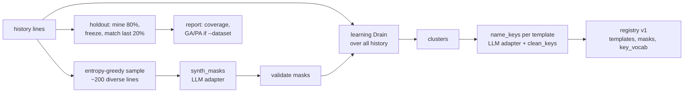
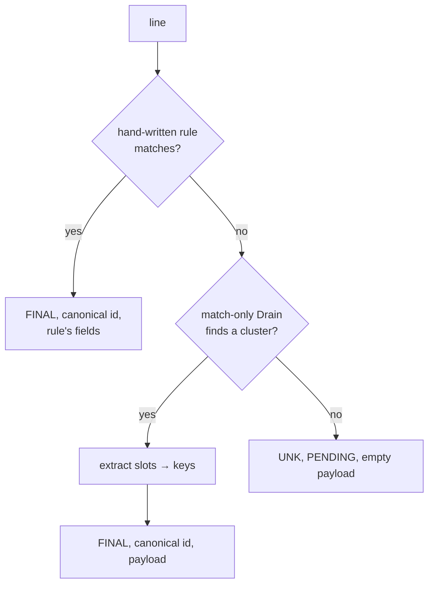

# Parsing and the registry

## Masks → Drain → templates

A **mask** is a typed regex placeholder (`<VAR:IPV4>`, `<VAR:NUM>`, `<VAR:HEX>`, …) applied to a
line before Drain tokenises it. Masks come from DeepParse's synthesiser (`deepparse.synth`):
offline rules, the fine-tuned DeepSeek-R1 LoRA (`hf`) or a chat model. They're validated
(`enrich/validate.py`: no catastrophic regexes, nothing that matches everything) and merged
with predefined masks (`calibrate.with_predefined_masks`, e.g. the IoT `MEASURE` mask).

Drain (`DeepParse/deepparse/drain/drain_engine.py`) is a fixed-depth prefix tree over token
count and leading tokens. A line joins the most similar cluster in its leaf if the similarity
is ≥ the threshold, else it starts a new one. logpipe builds every Drain through one function,
`parsing/engine.py:make_engine` (depth 5, similarity 0.4), so calibration, the frozen hot-path
tree and the worker's shadow tree always bucket lines the same way.

## Calibration: registry v1

`logpipe calibrate` (`calibrate.py`):

- **Holdout coverage**, with no labels needed: the share of the newest 20% of lines that a
  registry mined from the older 80% resolves without going PENDING. This is the share of
  fresh traffic the hot path would handle immediately.
- **GA / PA**, given ground truth: DeepParse's grouping and parsing accuracy, next to the plain
  DeepParse configuration as a baseline. `--tune` grid-searches Drain depth and similarity.

The server does the same per source through the review flow: `calibrate()` the first time,
`append_drafts()` later (only lines the current registry can't match), with results as
**drafts** for a person to approve (see [Server lifecycle](../agent-platform.md)).

## The registry

`registry.py` is the single owner of template ids.

| id | meaning |
|---|---|
| 0 | `UNSET` |
| 1 | `UNK`: no template matched (row is `PENDING`) |
| 2+ | real templates, allocated monotonically, never reused |

A `RegistrySnapshot` is immutable: `version`, `templates` (`TemplateEntry`: tokens, keys,
`alias_of`, optional hand-written `rule`), `masks` and `key_vocab`. Every change
(`publish`, `alias`, `unalias`, `replace`) returns a new snapshot with `version + 1`, saved
atomically to `registry.json`.

**Aliases.** `alias_of` links a template to an existing one: the same event at a different
generalisation, or reworded by a firmware update. `canonical_id()` follows the chain. Rows keep
their own id, while anomaly models and RCA count the canonical one, so a rewording doesn't look
like a brand-new event to LogBERT.

## The frozen parser (hot path)

`parsing/frozen_parser.py`:

- **Match-only.** The frozen tree never adds clusters, so parsing is a lookup: about 30 µs at
  p50 and 70 µs at p99 on the IoT fleet (Python, one core).
- **Rules first.** A template can carry a Datadog-style rule
  (`%{integer:pid} … %{data:statement}`, see `parsing/grok.py`). Rules are tried in order before
  the tree. That's fine for the tens a person writes; index them by first literal word if there
  are ever thousands (marked `shortcut:` in the code).
- **Payload extraction** (`parsing/kv.py`): each template compiles to a regex whose groups are
  its slots. Keys come from the registry, which got them from the LLM or `default_keys`:
  `temp=<VAR:NUM>` gives `temp`, a bare `<VAR:IPV4>` gives `ipv4`, anything else gives `var`, with
  numeric suffixes for duplicates.
- **Hot swap.** `ParserHandle.swap(snapshot)` builds a new `FrozenParser` and replaces the
  reference only if the version is newer, so a parse in flight finishes on the old tree.

## Timestamps

`sources/timestamps.py` reads the event time from the line itself (ISO, syslog, common
app formats). An agent sends its host's UTC offset, so a zone-less time in a line is read as
that host's wall clock; a zone written in the line always wins. With no time in the line, the
agent's read time (or `observedTimeUnixNano` for OTLP) is used.

## Levels

Levels aren't stored. They're computed from the line the same way in Python, ClickHouse (RE2)
and MongoDB (PCRE) from one rule table (`server/stores/base.py:LEVEL_RULES`), so facet counts
and rows read in Python always agree. A severity the sender stated (OTLP `severityNumber` → a
`severity:<level>` tag) wins over the text.
