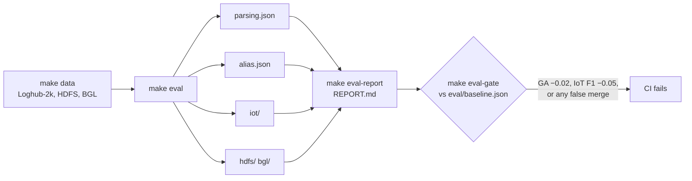

# Benchmarks

Each stage has its own benchmark, so a regression points at the component that caused it.

| Benchmark | Measures | Data | Command |
|---|---|---|---|
| **Parsing** | grouping / parsing accuracy (GA / PA), holdout coverage | Loghub-2k, 14 systems + the IoT fleet | `make eval-parsing` |
| **Alias** | wrong and missed merges of reworded templates | 28 hand-labelled template pairs | `make eval-alias` |
| **IoT end to end** | P / R / F1 of alerts, resolve lag, PENDING left, LLM calls | synthetic fleet with a firmware rollout and injected anomalies | `make eval-iot` |
| **LogBERT** | F1 per unknown-template mode, novelty on/off | HDFS, BGL (CPU-sized subsets) | `make eval-hdfs`, `make eval-bgl` |
| **RCA, synthetic** | evidence recall, answer correctness, ablations | 15 injected faults + 2 controls (+2) on a generated web shop | `python -m logpipe.eval.rca_eval` |
| **RCA, RCAEval** | AC@1/3/5, Avg@5 by fault type | real microservice testbeds (RCAEval RE2/RE3) | `make eval-rcaeval` |
| **Throughput** | lines/s one server sustains, CPU, RSS, latency | IoT fleet replayed at rising rates | `logpipe bench` |

## How they're run

- Everything in CI runs with `LLM_BACKEND=offline`: deterministic, no paid calls. The nightly
  workflow runs reduced parsing, alias and IoT evals and the gate ([CI](../ci.md)).
- LLM evals record replies (`--record`) so a run can be replayed and re-scored without the
  model (`--replay`, `tests/test_rca_replay.py`).
- RCAEval runs cache every answer and LLM reply and keep full transcripts
  ([RCAEval](rcaeval.md#caching-and-transcripts)).

## Headline numbers

| | Result | vs |
|---|---|---|
| Parsing GA (tuned, macro over 14) | **0.810** | DeepParse 0.703 |
| Alias false merges (offline rules) | **0** / 28 | always-yes LLM: 2, token similarity: 10 |
| IoT fleet F1 (full) | **0.556** | no fleet suppression 0.338, mask unknowns 0.264 |
| BGL F1 (LogBERT + novelty) | **0.953** | without novelty 0.869 |
| HDFS F1 (LogBERT + novelty) | **0.802** | without novelty 0.670 |
| RCA synthetic, top lead correct | **0.95** (18/19) | evidence recall 1.0 vs naive 0.73 |
| RCAEval RE3-OB AC@1, Claude Code + MCP | **0.87 – 0.90** | rules 0.40, rules + Gemini 0.70 |
| Hot-path parse latency | p50 **32 µs**, p99 68 µs | — |
| One server, memory store | ~**10k** lines/s on one core | ClickHouse ~5k |

Full tables and caveats: [Results](results.md) · [RCAEval](rcaeval.md) · [Throughput](../benchmark.md)
