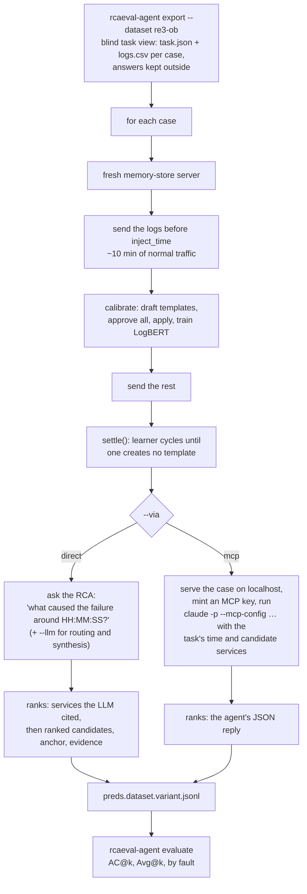

# RCAEval

[RCAEval](https://github.com/phamquiluan/RCAEval) (MIT) publishes 735 labelled failure cases
from real microservice testbeds (Online Boutique, Sock Shop, Train Ticket) and a scorer that
works with any method. It's the held-out test for logpipe's root-cause analysis: none of its
heuristics were tuned on these cases.

## What can be scored

logpipe reads **logs only**, so:

| Suite | Logs? | Usable |
|---|---|---|
| RE1 (375 cases) | no, metrics only | ✗ |
| RE2 (270): cpu, mem, disk, delay, loss, socket faults | yes | ✓ but resource faults leave few log traces |
| RE3 (90): code-level faults F1–F5 | OB and TT; not SS | ✓ the fair test |

Only the **service level** is scored. The indicator level (`checkoutservice_cpu`) needs metrics.

## How a case is answered



- The question carries the injection time, the same signal RCAEval's classic methods get.
  `--no-anchor` asks "what caused the failure in the last 20 minutes?" instead.
- Each log row's `container_name` is the service and `pod_name` the host; both match RCAEval's
  candidate list.
- RCAEval isn't a dependency: it runs through `uvx --from 'RCAEval[core]'` (the `core` extra,
  because the base package doesn't declare everything it imports).

## Results: RE3-OB

30 cases, Online Boutique, run 2026-11-12. Fault types: F1 9 cases, F2 3, F3/F4/F5 6 each. Root
cause services: `emailservice` 15, `adservice` 9, `cartservice` 3, `currencyservice` 3.

| setup | AC@1 | AC@3 | AC@5 | Avg@5 | Lift@5 | mean time / case | mean cost / case |
|---|---|---|---|---|---|---|---|
| rules only (`full`) | 0.40 | 0.40 | 1.00 | 0.56 | 0.32 | 65 s | — |
| rules, no LogBERT | 0.40 | 0.40 | 1.00 | 0.56 | 0.32 | 63 s | — |
| rules, no semantic | 0.40 | 0.40 | 1.00 | 0.56 | 0.32 | 63 s | — |
| **rules + Gemini** (`full+llm`) | **0.70** | **0.77** | 1.00 | **0.81** | 0.57 | 128 s | web chat |
| rules + Gemini, no LogBERT | 0.67 | 0.73 | 1.00 | 0.79 | 0.54 | 95 s | web chat |
| rules + Gemini, no semantic | 0.67 | 0.73 | 1.00 | 0.79 | 0.54 | 95 s | web chat |
| **Claude Code + MCP, with `ask`** | **0.87** | 0.87 | 0.90 | **0.88** | 0.64 | 122 s | $0.23 (235k in / 1.4k out tokens, 9 tool calls) |
| **Claude Code + MCP, raw tools** | **0.90** | 0.90 | 0.90 | **0.90** | 0.66 | 118 s | $0.22 (221k in / 1.4k out, 8.7 tool calls) |

Chance@5 is 0.24 for every setup. The Claude Code cost is the API-price figure Claude Code
reports. The runs used a Claude Code login, not an API key.

**Avg@5 by fault type:**

| setup | F1 | F2 | F3 | F4 | F5 |
|---|---|---|---|---|---|
| rules only | 0.51 | 0.20 | 0.67 | 0.67 | 0.60 |
| rules + Gemini | 0.78 | 0.93 | 0.73 | 0.73 | 0.97 |
| Claude Code + `ask` | 0.60 | 1.00 | 1.00 | 1.00 | 1.00 |
| Claude Code, raw | 0.67 | 1.00 | 1.00 | 1.00 | 1.00 |

## Findings

1. **The rules alone find the area but not the service.** The answer is always in the top 5
   (AC@5 = 1.0) but first only 40 % of the time. The miss is systematic: `emailservice` is the
   root cause in 15 cases, and the rules never rank it first. They lead with its caller
   `checkoutservice` (9 times) or with `frontend` (6), whose errors are louder and come from more
   lines. The `adservice` cases (9) are all right. F2 (3 cases) is at chance level.
2. **An LLM on top of the ranking nearly doubles AC@1** (0.40 → 0.70), with the same evidence
   bundle: Gemini names `emailservice` first in 9 cases where the rules named its caller. It
   reads a checkout error that *says* the email call failed as pointing at the email service,
   which the anomaly × rarity × proximity score, counting lines per service, can't.
3. **A strong agent with raw tools does best** (0.90), reading ~220k tokens per case against
   the ~6k-token evidence bundle the synthesizer gets. It reads the logs itself, writes its own SQL, and rarely used `ask` (8 calls over
   30 cases). On this set `ask` didn't change its accuracy; its value is cheaper context, which a
   harder or larger system may need more.
4. **LogBERT and semantic search make no difference here.** Each case has only ~10 minutes of
   normal logs to train LogBERT on, and the question names a time but no service, so the
   LogBERT surprise and neighbour factors rarely apply.
5. **F1 is the hard type for everyone**, the only one where Claude Code stays below 0.7.

!!! warning "Caveats"
    - Every run above predates `settle()` (`c615e33`): cases were enriched with a fixed 3 learner
      cycles. Rerun with `FRESH=1` for numbers on the current code.
    - RCAEval cases hold about 10 minutes of logs before the fault, while the RCA reads 30
      minutes back and builds a 24 h baseline by default. Fitting the window
      (`LOGPIPE_RCA_BEFORE_MINUTES` and the other `LOGPIPE_RCA_*` settings) hasn't been scored.
    - Web-chat Gemini picks its own model, so its runs aren't exactly reproducible; the recorded
      replies are.
    - One `mcp-raw` case failed and counts as a miss; `mcp+ask`'s AC@5 of 0.90 means 3 answers
      didn't include the right service at all.

## Run it

```sh
make eval-rcaeval DATASET=re3-ob                                       # rules only
make eval-rcaeval DATASET=re3-ob LLM=llm:web:gemini BROWSER=chromium   # + Gemini
make eval-rcaeval DATASET=re3-ob VIA=mcp                               # Claude Code over /mcp
make eval-rcaeval DATASET=re3-ob VIA=mcp LIMIT=3 VARIANTS=mcp+ask      # a quick try
make eval-rcaeval DATASET=re3-ob FRESH=1                               # ignore the cache
```

The first run exports the dataset (downloads ~4 GB into `artifacts/eval/rcaeval/data`). Each
line of output is one answer, with a block progress bar:

```
re3-ob: 30 cases x 3 variants, 9 cached, 81 to run
[█░░░░░░░░░░░░░░░░░░░░░░░░░░░░░] 3/81  4m elapsed, eta 104m  re3-ob-0004 full+llm: emailservice, checkoutservice, frontend (68 s)
```

## Caching and transcripts

Everything is in `artifacts/eval/rcaeval/`:

| Path | What |
|---|---|
| `tasks/<dataset>/cases/*/` | the blind task view (`task.json`, `logs.csv`, …) |
| `tasks/<dataset>.answers.jsonl` | labels; never read by the bench |
| `preds.<dataset>.<variant>.jsonl` | one answer per case, scored by RCAEval |
| `llm-replies.<dataset>.json` | every LLM reply by prompt hash, reused on reruns |
| `transcripts/<dataset>.<variant>.reports.jsonl` | the full RCA report per case |
| `transcripts/<dataset>.<variant>+llm.llm.jsonl` | every prompt sent to the LLM, the reply or error, timing |
| `transcripts/<dataset>.mcp+ask/<case>.jsonl` | Claude Code's full stream: prompt, each tool call and result, final answer |

- An answered case is skipped on the next run; a failed one is retried and replaced.
- A saved LLM reply is reused for the same prompt, so variants that send identical prompts share
  one call.
- `FRESH=1` (`--fresh`) ignores saved answers and replies.
- Loading a case (replay + calibration, ~60–75 s) isn't cached.

## How the code is laid out

`logpipe/eval/rcaeval_bench.py`: `load_case` (replay + calibrate + settle), `answer_direct`,
`answer_mcp` (uvicorn on a free port, the server's job loop while the agent runs, an MCP key,
`claude -p --output-format stream-json`), `ranks`, `Transcript` (logs every LLM call), and the
cache (`load_preds` / `save_preds`, written atomically per case). Tests:
`tests/test_rcaeval_bench.py` (a hand-made case, ranking from LLM citations, resume/retry/fresh,
transcripts, reply reuse).
