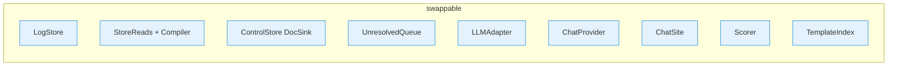

# Replacing components

Each swappable part sits behind a small protocol and is chosen in one factory. To add an
implementation: write the module, register it in the factory, add the CLI choice, write a test
against the protocol (the memory implementation is always the reference).



| To replace… | Implement | Register in | Selected by |
|---|---|---|---|
| where rows go | `storage/base.py:LogStore` | `storage/__init__.py:open_store` | `--store`, `STORE` |
| how the UI and Ask read them | `server/stores/base.py:StoreReads` + `Compiler` | `server/stores/__init__.py:reads_for` | the store's type |
| the control plane | `server/control.py:DocSink` | `server/__init__.py:run` | `--store` |
| the unresolved queue | `unresolved/base.py:UnresolvedQueue` | `unresolved/__init__.py:open_queue` | `--queue`, `QUEUE` |
| the LLM for masks / keys / aliases / Ask | `enrich/llm.py:LLMAdapter` | `enrich/llm.py:get_adapter` | `--llm`, `LLM_BACKEND` |
| a hosted chat vendor | `deepparse/providers/base.py:ChatProvider` | `deepparse/providers/registry.py` | `llm:<name>[:<model>]` |
| a web chat site | `deepparse/ai_scraper/sites.py:ChatSite` | `SITES` in the same file | `llm:web:<site>` |
| the anomaly model | `anomaly/scorer.py:Scorer` | where the pipeline / server loads models | `--model`, per-stream dirs |
| the template vector index | `search()` + `neighbours()` of `ask/index.py:TemplateIndex` | `AskService.index_for` | `LOGPIPE_ASK_MODEL` for the text model |
| Drain parameters | — | `parsing/engine.py:make_engine` | `calibrate --depth --similarity --tune` |

## A storage backend

Three pieces, in this order:

1. **Write path**: a class with the `LogStore` methods:

    ```python
    class MyStore:
        def insert_logs(self, rows: Sequence[LogRow]) -> None: ...
        def insert_alerts(self, alerts: Sequence[AnomalyAlert]) -> None: ...
        def fetch_pending(self, limit=10_000, template_id=None) -> list[LogRow]: ...
        def count_by_status(self) -> dict[str, int]: ...
        def flush(self) -> None: ...
        def close(self) -> None: ...
    ```

    The one rule to keep: **the highest `version` per `log_id` wins**. A back-fill re-inserts a
    row with the same `log_id` and a higher version, and a redelivered batch inserts the same
    version again. ClickHouse does it with `ReplacingMergeTree(version)` + `FINAL`, MongoDB
    with `ReplaceOne({_id, version: {$lte: v}}, upsert=True)`. Add it to `open_store`, to the
    `Literal` in `settings.AppSettings.store`, and to the `--store` choices in `cli.py`.

2. **Read path**: subclass `StoreReads` (Log Explorer pages, `between`, `histogram`, `top`,
   `source_lines/rows`, `alerts`, `query`, `records`) and `Compiler` (`build` for the visual
   builder, `schema`, `rows`, `template_counts`, `buckets`, `template_sample` for Ask). Use the
   shared `LEVEL_RULES` so levels match every other backend. Register it in `reads_for`. The SQL
   compiler in `stores/sql.py` already covers ClickHouse and SQLite dialects; a SQL backend
   usually only needs its dialect quirks.

3. **Control plane** (optional): a `DocSink` with `load()` and `write(kind, id, doc | None)`.
   Without one the control docs live in memory and are lost on restart.

Then run the server tests on it (`tests/test_server_clickhouse.py` and `test_server_mongo.py`
show how: the same suite with `STORE=…`) and add an integration marker.

## A queue

```python
class MyQueue:
    def publish(self, row: LogRow, *, attempts: int = 0) -> None: ...   # never block the caller
    def consume(self, max_messages: int, timeout: float = 1.0) -> list[Message]: ...
    def commit(self) -> None: ...          # ack the last consumed batch
    def dead_letter(self, message: Message, reason: str) -> None: ...
    def flush(self, timeout: float = 10.0) -> None: ...
    def stats(self) -> QueueStats: ...
    def close(self) -> None: ...
```

Contract: `consume` returns the same batch again until `commit`; the worker commits only after
back-fill and re-queue, which gives at-least-once delivery. `publish` must not block the fast
path: buffer locally if the broker is slow (see `KafkaQueue`'s spill buffer). Reuse
`unresolved/codec.py` for the wire format. Tests: `tests/test_unresolved_queue.py` runs the
worker's commit / re-queue / dead-letter behaviour against any queue.

## An LLM backend

The fastest route is usually **not** a new adapter but a new chat provider (below), which
`ChatAdapter` wraps for all four jobs. Write an `LLMAdapter` only for a different kind of model
(like `HFDeepSeekAdapter`, which runs a local fine-tune for masks only):

```python
class MyAdapter(OfflineAdapter):          # inherit safe offline fallbacks
    MODE = "mine"
    def synth_masks(self, lines, sample_size) -> list[Mask]: ...
    def name_keys(self, tokens, samples) -> list[str]: ...
    def confirm_alias(self, new_tokens, old_tokens, new_samples) -> bool: ...
    def ask(self, schema, prompt): ...     # structured answer for Ask, or raise NeedsLLM
```

Register it in `get_adapter`'s `adapters` dict. Everything it returns is validated by the
callers (`enrich/validate.py`, `ask/synth.py` citations, `spec.validate`), so it doesn't need
its own guards. Add a hostile line to `tests/fixtures/prompt_injection.txt` if it adds a new
kind of call.

## A hosted chat provider

One module implementing `ChatProvider` (`name`, `default_model`, `build()` returning a
LangChain chat model, `structured()` returning `{"raw", "parsed", "parsing_error"}`, and
`price()`), and one line in `providers/registry.py`. It's then usable as `llm:<name>` and
`llm:<name>:<model>` everywhere: CLI, server, evals, `make … LLM=llm:<name>`.

## A web chat site

Sites are data (`deepparse/ai_scraper/sites.py`):

```python
"mychat": ChatSite(
    name="MyChat",
    url="https://mychat.example/new",                 # opening it starts a fresh chat
    composer=("div[contenteditable='true']",),         # most specific first
    send_button=("button[aria-label='Send']",),
    generating=("button[aria-label='Stop']",),         # present only while streaming
    responses=("div.assistant-message",),              # one per reply, in order
    login_urls=("/login",),
    logged_out=("a[href*='login']",),
    error_banners=("[role='alert']",),
    reject_cookies=("button:has-text('Reject all')",), # answered automatically
    more_cookie_options=(),                            # what reveals a hidden reject button
),
```

When a site redesigns, add a selector at the **front** of the tuple; no code change. Check with
`make web-check SITE=mychat` and `make web-ask SITE=mychat PROMPT="Reply with OK."`. A failed
run saves the page, a screenshot and the error under `DeepParse/.webchat/errors/`.

## The anomaly model

The detector needs a `Scorer`:

```python
class Scorer(Protocol):
    version: str
    vocab: TemplateVocab
    def score(self, windows, familiar=...) -> list[WindowScore]: ...  # length, masked, undetected, unknown, distance
    def reasons(self, score, thresholds=None) -> tuple[str, ...]: ...
```

A different sequence model fits by filling `WindowScore` (`undetected / masked` becomes its
miss ratio). RCA also calls `explain(window)` for per-line `expected | unexpected | unseen`
verdicts; without it, RCA ranks without the LogBERT factor (and says so in the report notes).

## The vector index

`TemplateIndex.search(text, k)` (question → templates) and `neighbours(tid, k)` (templates
that occur in the same places) are brute-force cosine over numpy, because templates number in
the hundreds. A vector database fits by implementing those two methods; the text model is
`LOGPIPE_ASK_MODEL` (any sentence-transformers model).

## Sources

Anything that yields `sources/file_replay.LogEvent(device_id, source, line_no, line, service,
tags, time)` can feed `Pipeline.process` or `Server.process`. For a live system, prefer sending
OTLP/HTTP logs to `POST /v1/logs`: the OpenTelemetry Collector, any OTel SDK and
`logpipe-agent` already speak it.
