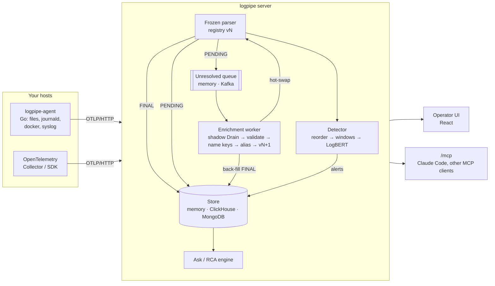

---
hide:
  - navigation
---

# logpipe

**Streaming log parsing that learns new formats on its own, flags unusual sequences with
LogBERT, and answers "why did it break?" with an evidence report that cites real log lines.**

logpipe takes raw log lines from files, Go agents on your hosts or any OpenTelemetry sender. It
parses them on a sub-millisecond hot path, learns templates for lines it has never seen without
stopping ingestion, scores per-source sequences with LogBERT, and serves an operator UI, a SQL
and visual query layer, an approval-gated "Ask" box and an MCP endpoint for AI assistants.

<div class="grid cards" markdown>

-   :material-lightning-bolt: **Fast path that never waits**

    ---

    A frozen, match-only Drain tree parses each line in about 30 µs at the median. Lines it can't match are stored as `PENDING` right away, and nothing blocks on a model. [Parsing →](architecture/parsing.md)

-   :material-school: **Learns new log formats online**

    ---

    A background worker clusters the unknown lines, validates a template, names its fields, checks whether it's the same event as an old template, publishes registry vN+1, hot-swaps the parser and back-fills the stored rows. [Online learning →](architecture/enrichment.md)

-   :material-chart-bell-curve: **Sequence anomalies, not keyword alerts**

    ---

    LogBERT models per stream score sliding windows of template ids. Novel templates are a separate signal, and fleet suppression keeps a firmware rollout from paging you. [LogBERT →](architecture/anomaly.md)

-   :material-magnify-scan: **Root cause with citations**

    ---

    An anchor (when did it break) → a scored evidence bundle → an LLM that must cite every claim. Every read waits for approval, unless you switch approval off. [Ask & RCA →](architecture/ask-rca.md)

-   :material-robot: **MCP for Claude and friends**

    ---

    An allowlisted `/mcp` endpoint with per-person keys: search logs, triage incidents, pre-review templates, and `ask` the RCA engine. [MCP →](architecture/mcp.md)

-   :material-database: **Pluggable everywhere**

    ---

    Memory, ClickHouse or MongoDB storage; an in-process or Kafka queue; offline rules, a hosted API, a fine-tuned model or your signed-in web chat as the LLM. [Replacing components →](guides/replace-components.md)

</div>

## How it fits together



## Who it's for

The main user is an **on-call engineer or IoT/platform operator** who runs their own services
or device fleet. They read logs and SQL fluently and are under time pressure during an
outage. They want three things from their logs without hand-writing parsers:

1. **Structure**: every line turned into a template id and named fields, even after a firmware
   or service update changes the formats.
2. **Early warning**: unusual sequences flagged per device or stream, without alert storms when
   a rollout ships a new event type.
3. **Fast, trustworthy answers**: "why did checkout fail at 14:05?" answered from their own logs,
   with every claim pointing at a line they can open. The answer says "insufficient evidence"
   when that's the truth.

A person stays in charge: templates go live only after review (or through the online learner
for traffic that can't wait), every Ask query can require approval, and an AI assistant over
MCP can propose but never apply.

## Headline results

| what | benchmark | result |
|---|---|---|
| Parsing | Loghub-2k, 14 systems, tuned | GA **0.81** macro (DeepParse 0.70) |
| Alias decisions | 28 labelled template pairs, offline rules | **0** false merges, recall 0.6 |
| Anomaly detection | BGL, LogBERT + novelty | F1 **0.95** |
| Anomaly detection | HDFS, LogBERT + novelty | F1 **0.80** |
| Root cause, synthetic | 19 injected faults on a web shop | evidence recall **1.0**, top lead correct **0.95** |
| Root cause, real testbed | RCAEval RE3-OB (30 code-level faults), Claude Code over MCP | AC@1 **0.87–0.90** |
| Root cause, real testbed | RCAEval RE3-OB, rules + Gemini | AC@1 **0.70**, Avg@5 0.81 |
| Hot path | IoT fleet replay | parse p50 **32 µs**, p99 68 µs |

Methods, caveats and full tables: [Benchmarks](benchmarks/index.md).

## Start here

=== "Try it in a browser"

    ```sh
    uv sync --group dev
    uv run logpipe demo          # synthetic IoT fleet, the whole pipeline live in a page
    ```

=== "Run the platform"

    ```sh
    cp .env.example .env
    docker compose --profile platform up --build    # UI on http://localhost:8080
    ```

=== "Guided tour"

    ```sh
    uv run logpipe showcase --auto   # server + a web shop's logs + a real agent, 8 acts
    ```

Next: [Install](getting-started/install.md) · [Run it](getting-started/run.md) ·
[Architecture](architecture/index.md) · [Code structure](guides/code-structure.md)
